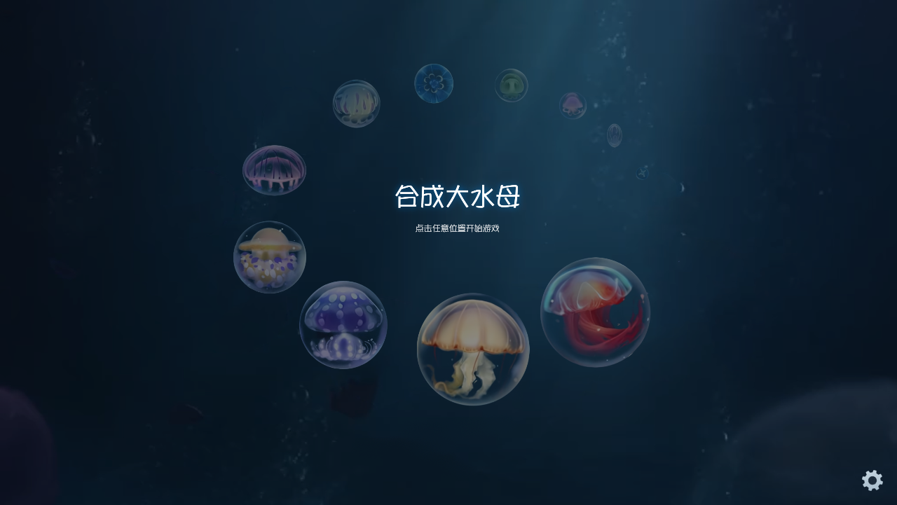
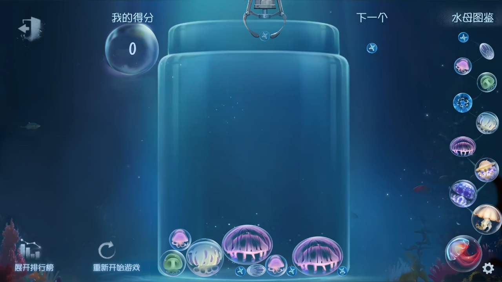
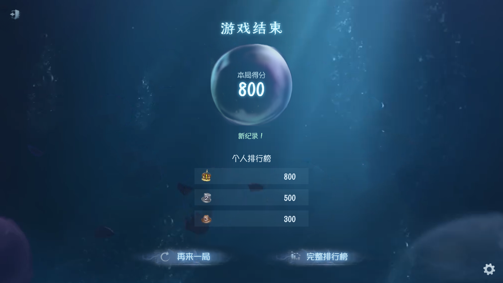

# 合成大水母

<p align="center"></p>
<p align="center">轻轻放下，让两只相同的水母变成更大的一只。</p>
<p align="center"><a href="https://github.com/HenryChen27/crypticNotes">搭配加页手记地图助手</a> · <a href="https://github.com/HenryChen27/mini_games/releases">下载游戏资源</a></p>



一个用 HTML、Canvas 和 Planck.js（保留 Matter.js 数据接口） 制作的水母合成小游戏。水母会呼吸、晃动、碰撞与合成；气泡过场、海底背景、音乐和音效一起构成游戏画面。支持鼠标、触摸和键盘，不需要安装 Node.js 依赖。

## 怎么玩



- 鼠标或触摸移动抓手，松开投放水母。
- 左右方向键移动，Enter 或下方向键投放。
- 相同等级的水母相遇会合成，注意顶部危险区域。
- 右下角齿轮调整背景音乐、音效音量；左下角的独立按钮可重新开始。

浏览器可能要求首次点击或按键后才能播放声音。

## 存档与个人记录

重新打开游戏后可选择继续存档或新开一局。游戏过程中在投放、合成与危险状态变化时保存，定期兜底保存；危险倒计时不会因中断而重置。

结算显示本局成绩与个人记录，排行榜是本机可见的个人排行，不是在线比赛。进度、成绩与声音设置保存在本地；清除浏览器网站数据会删除浏览器版记录。



## 本地运行

在项目目录执行：

```sh
python -m http.server 8000
```

打开 `http://localhost:8000`。使用本地 HTTP 服务比直接双击 HTML 更适合加载资源和保存记录，无需构建步骤。

## 在地图助手里玩

[加页手记地图助手](https://github.com/HenryChen27/crypticNotes) 提供可选下载入口，以悬浮窗口运行，不另开浏览器页面。小游戏资源包、启动器与存档分别管理，删除资源包不等于清空存档。

宿主提供全屏／恢复窗口、最小化与关闭按钮。手机后台用蓝水母替换悬浮球，双击恢复游戏，单击打开插件设置。可用功能取决于安装的插件版本；游戏仓库本身不负责系统窗口管理。

插件采用系统网页引擎承载游戏。游戏的玩法、界面、音视频资源仍来自这个仓库，宿主只负责窗口和安全存档通信。

## 项目目录

| 目录／文件 | 内容 |
| --- | --- |
| `index.html` | 游戏入口 |
| `js/` | 物理、合成、动画、存档与界面逻辑 |
| `css/` | 样式 |
| `assets/` | 图片、视频、声音和字体 |
| `tests/` | 验证脚本与效果预览 |

修改游戏请在这里更新源文件，再重新生成游戏资源包。插件仓库里的宿主改动不会自动反向修改这个游戏仓库。

素材说明见 `assets/assets.txt`、`assets/fonts/README.txt` 与 `assets/audio/SOURCES.md`。作者：[被诅咒的无名布偶](https://space.bilibili.com/3747565201787057/)。
